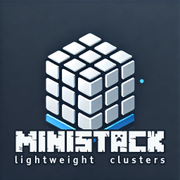

# Ministack



Ministack is a lightweight, local environment tool designed to mimic a Minikube-like experience for HashiCorp's suite of tools: **Nomad**, **Consul**, and **Vault**. It allows you to easily deploy and manage local clusters, simplifying development and testing workflows.

---

## Features

- **Local Cluster Deployment**: Quickly launch and manage local clusters for Nomad, Consul, and Vault.
- **Configuration Flexibility**: Define and manage multiple cluster configurations using YAML files.
- **Simplified CLI Commands**: Start and stop clusters effortlessly with command-line tools.

---

## Installation

To install Ministack, follow this step:

```sh
$ curl -fsSL https://raw.githubusercontent.com/gperreymond/ministack/main/install | bash
```

Supported: Linux x86_64, macOS Intel and Apple Silicon (native binary).  
The binary goes into `/usr/local/bin` (sudo is asked only if needed), use `INSTALL_DIR` to change it:

```sh
$ curl -fsSL https://raw.githubusercontent.com/gperreymond/ministack/main/install | INSTALL_DIR=~/.local/bin bash
```

---

## Usages

Automatic usage:
```sh
# start the cluster, and wait until every node is healthy
$ ministack --config [path_to_your_config_yaml_file] --start
# export NOMAD_ADDR (and NOMAD_SKIP_VERIFY when tls is enabled) in your shell
$ eval "$(ministack --config [path_to_your_config_yaml_file] --env)"
$ nomad node status
# recreate all containers
$ ministack --config [path_to_your_config_yaml_file] --restart
# stop the cluster, data is kept
$ ministack --config [path_to_your_config_yaml_file] --stop
# stop the cluster, and delete all its data (docker volumes)
$ ministack --config [path_to_your_config_yaml_file] --purge
```

Some details:
* The nomad api of the first server is published on `127.0.0.1:4646` (change it with `services.nomad.config.server.host_port`, or disable it with `false`). It works on Linux and macOS.
* Inside every node, `NOMAD_ADDR` is already set, so `docker exec <node> nomad status` just works.
* Nodes are healthy only when the nomad api answers `/v1/agent/health` (a leader is elected, clients are registered).
* Nomad and Consul binaries are baked into the `hashibase` image (amd64 and arm64). Setting `services.nomad.version` to another version downloads it at container start.
* Extra ports can be published per node with `ports`, for example `ports: ['8080:8080']`.

But you can also, only generate the docker compose files, and manage manually:
```sh
$ ministack --config examples/europe-paris/cluster.yaml
$ docker compose --file examples/europe-paris/.ministack/cluster.yaml up -d
$ docker compose --file examples/europe-paris/.ministack/cluster.yaml down
```

This approach is ideal if you want to add some docker compose services you created, or working on a customization of nomad files.

---

## Cluster configuration details

This is the minimum configuration to have a fully working nomad server/client.  
With this configuration and those command lines, you can start working with nomad.

```sh
$ ministack --config examples/nomad/minimum/cluster.yaml --start
$ ministack --config examples/nomad/minimum/cluster.yaml --stop
```

```yaml
name: 'nomad-minimum'
datacenter: 'localhost'

services:
  nomad:
    enabled: true
    servers:
      - name: 'server'
    clients:
      - name: 'worker-1'
      - name: 'worker-2'
```

This is a full example if you decide to use all the custom values.  
You can find a full usage into __examples/europe-paris__. This approach let you really customize nomad, and adding __plugins__.  
Plugins are pieces of docker compose services you managed and integrate into the stack.  
You will find traefik as plugin into this example.

```yaml
name: 'europe-paris'
datacenter: 'europe-paris'

network:
  subnet: '10.1.20.0'

plugins:
  - 'plugins/traefik.yaml'

services:
  nomad:
    enabled: true
    version: '1.9.5'
    config:
      # tls certificates created by ministack (.ministack/tls)
      tls: true
      bind_addr: '{{ GetInterfaceIP \"eth0\" }}'
      log_level: 'info'
      server:
        bootstrap_expect: 3
        labels:
          - 'traefik.enable=true'
          - 'traefik.http.routers.nomad.rule=Host(`nomad.docker.localhost`)'
          - 'traefik.http.routers.nomad.entrypoints=web'
          - 'traefik.http.services.nomad.loadbalancer.server.port=4646'
          - 'traefik.http.services.nomad.loadbalancer.server.scheme=https'
          - 'traefik.http.services.nomad.loadbalancer.serverstransport=insecure@file'
        # retry_join:
        #   - 'provider=aws tag_key=... tag_value=...'
        #   - 'provider=azure tag_name=... tag_value=... tenant_id=... client_id=... subscription_id=... secret_access_key=...'
    servers:
      - name: 'nomad-server-1a'
        labels:
          - 'server=1a'
      - name: 'nomad-server-1b'
        labels:
          - 'server=1b'
      - name: 'nomad-server-1c'
        labels:
          - 'server=1c'
    clients:
      - name: 'worker-system'
      - name: 'worker-monitoring'
        local_volumes:
          - 'prometheus/rules:/mnt/prometheus/rules'
          - 'prometheus/scrape_configs:/mnt/prometheus/scrape_configs'
        docker_volumes:
          - 'prometheus_data'
```

---

## Consul

Enable consul, and every nomad node (server and client) gets a consul client agent.  
Nomad registers its services in consul, and the consul service mesh (connect + envoy sidecars) works out of the box.

```sh
$ ministack --config examples/consul/minimum/cluster.yaml --start
$ eval "$(ministack --config examples/consul/minimum/cluster.yaml --env)"
$ nomad job run examples/consul/minimum/jobs/countdash.hcl
$ consul catalog services
# the dashboard is on http://10.1.0.101:9002 (linux), consul ui on http://127.0.0.1:8500
```

```yaml
name: 'consul-minimum'
datacenter: 'localhost'

services:
  consul:
    enabled: true
    # version: '2.1.0'          # optional, another version is downloaded at start
    # config:
    #   log_level: 'info'
    #   server:
    #     bootstrap_expect: 1   # default: number of servers
    #     host_port: 8500       # consul api/ui on 127.0.0.1, false to disable
    servers:
      - name: 'consul'
  nomad:
    enabled: true
    servers:
      - name: 'server'
    clients:
      - name: 'worker'
```

Some details:
* Consul servers use the ip range `.21` to `.29` of the network, nomad servers `.11+`, nomad clients `.101+`.
* Nomad nodes wait for the consul servers to be healthy (a leader is elected).
* ACLs and TLS are disabled, this is a local development stack: all mesh traffic is allowed by default.

---

## Vault

Enable vault, and nomad jobs can read vault secrets with their **workload identity** (no vault token in jobs).  
In both modes: root token `root`, kv v2 engine on `secret/`, and `--start` returns only when vault is ready for nomad
(the `bootstrap` service runs `nomad setup vault`: jwt auth method `jwt-nomad`, role `nomad-workloads`).

| mode | storage | what happens at start |
|---|---|---|
| `dev` (default) | **in memory**, secrets are lost on `--stop` | vault starts unsealed |
| `raft` | **persistent** (docker volume), secrets survive `--stop` | first start: init (1 unseal key); every start: auto unseal |

In `raft` mode, the unseal key and the initial root token are kept in the `vault_keys` docker volume
(`docker exec <datacenter>-bootstrap cat /ministack/keys/init.json`). `--purge` deletes the vault data and its keys.

```sh
$ ministack --config examples/vault/minimum/cluster.yaml --start
$ eval "$(ministack --config examples/vault/minimum/cluster.yaml --env)"
# no vault cli on your host? use: docker exec localhost-vault vault kv put ...
$ vault kv put secret/default/vault-demo password=ministack
$ nomad job run examples/vault/minimum/jobs/vault-demo.hcl
$ nomad alloc logs -job vault-demo
password from vault: ministack
```

```yaml
services:
  vault:
    enabled: true
    # mode: 'raft'            # dev (default) or raft, see examples/vault/raft
    # version: '2.2.2'        # hashicorp/vault image tag
    # config:
    #   root_token: 'root'
    #   host_port: 8200       # vault api/ui on 127.0.0.1, false to disable
```

A job gets access to `secret/data/<namespace>/<job_id>` and `secret/data/<namespace>/<job_id>/*` (policy created by `nomad setup vault`).

The full stack (consul + vault + nomad) is in `examples/hashistack/cluster.yaml`.

---

## ACL

Nomad and consul ACLs can be enabled, independently. Like vault and its `root` token, each one gets a **known management token**
(a uuid, change it with `token`), exported by `--env` and set inside every node, so the cli keeps working without any extra step.

```yaml
services:
  consul:
    enabled: true
    config:
      acl:
        enabled: true
        # token: '22222222-2222-2222-2222-222222222222'
  nomad:
    enabled: true
    config:
      acl:
        enabled: true
        # token: '11111111-1111-1111-1111-111111111111'
```

```sh
$ ministack --config examples/acl/cluster.yaml --start
$ eval "$(ministack --config examples/acl/cluster.yaml --env)"   # NOMAD_TOKEN, CONSUL_HTTP_TOKEN, VAULT_TOKEN
$ nomad job run examples/consul/minimum/jobs/countdash.hcl
```

At every start, the `bootstrap` service (idempotent) does:
* nomad: `nomad acl bootstrap` with the management token.
* consul: `nomad setup consul` (jwt auth method `nomad-workloads`), so services and envoy sidecars get their consul tokens
  through the nomad **workload identities**, and an intention `* -> *` allow, so the service mesh behaves like without ACL.
* vault: as described above.

Local stack shortcuts, not for production: every consul agent (and nomad agent) uses the consul management token,
and the management tokens are written in the generated files.

---

## TLS

Nomad, consul and vault can be served over TLS, independently, with certificates **created by ministack**:

```yaml
services:
  consul:
    config:
      tls: true    # https on the consul port (8500 on the host), grpc tls for envoy, mtls between agents
  vault:
    config:
      tls: true    # https on 8200
  nomad:
    config:
      tls: true    # https on 4646, mtls between agents
```

```sh
$ ministack --config examples/tls/cluster.yaml --start
$ eval "$(ministack --config examples/tls/cluster.yaml --env)"   # also NOMAD_CACERT, CONSUL_CACERT, VAULT_CACERT
$ nomad node status && consul members && vault status
```

* Before starting, ministack runs `scripts/tls.sh` in a hashibase container: one CA (10 years) and the certificates of every node,
  with their names and ips. They are in `.ministack/tls`, owned by you.
* The CA is created once and kept, the certificates are recreated at every start (they always match the nodes).
  `--purge` deletes them with the rest of the cluster data.
* Inside the nodes, the CLIs are already configured (`*_ADDR` in https and `*_CACERT`).
* Plain http is refused. The integrations follow: nomad talks to consul and vault over TLS,
  `nomad setup consul/vault` give the CA to consul and vault to verify the nomad workload identities.

The closest to production: `examples/secure/cluster.yaml` (ACL + TLS everywhere, persistent vault).

---

## Some useful articles

* https://developer.hashicorp.com/nomad/docs/configuration
* https://github.com/GuyBarros/nomad_jobs
* https://romanzipp.com/blog/get-started-with-hashi-nomad-consul
* https://mrkaran.dev/posts/nomad-networking-explained
* https://last9.io/blog/mastering-prometheus-relabeling-a-comprehensive-guide
* https://samber.github.io/awesome-prometheus-alerts/rules.html

---

## Contributing

Contributions are welcome! Feel free to fork the repository and submit a pull request.

---
